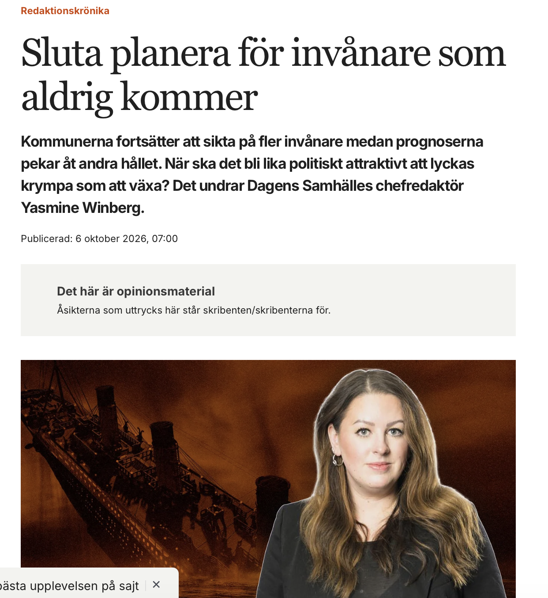

Yasmin jämför krympande kommuners dårskap med att vilja bli fler med musikerna som fortsatte spela tills Titanic sjönk. Och jag blir så sjukt less på att detta raljanta synsätt så ofta präglar stockholmsskribenters krönikor. 

Skulle man skriva något liknande om Stockholms tafatta ambitioner att växa i världen. Skulle man säga sluta drömma om att bli London – ni fattar ju att 10 miljoner är omöjligt? Lägg ner era drömmar. Var realistiska. Stockholm kommer aldrig bli en världsmetropol. 

Yasmin tror att vi krympande kommuner INTE funderar på: Vilken skola stänger först? Hur långt får det bli till äldreboendet? Behöver kommunen alla sina lokaler? Vilken service kan inte längre finnas överallt? Och framför allt: Hur ser politisk framgång ut i en kommun som blir mindre?

Kiss my ass. Det är en ständig pågående diskussion i dessa kommuner. Till stor vånda och enormt svåra beslut som tas, och har tagits. I min hemkommun har ett tiotal skolor lagt ner de senaste decennierna. Idag finns TVÅ kvar. På en yta lika stor som Blekinge. Är inte det att krympa så vette tusan? 

Allt som kunnat skalats av och bort har gjorts (i somras fylldes det enda tempererade badet i kommunen över med jord och är ett minne blott) samtidigt som pålagorna från staten och EU blir bara fler och fler. Som nu senast att man inte får samlokalisera skolbibliotek med folkbibliotek. För att nämna ett av hundratals exempel. En politik som inte alls är anpassad efter våra förhållanden. 

Att skriva att kommunerna inte fattar är ett tecken på att man inte själv varit med där i de rummen där diskussionen är ständigt pågående. Det handlar om att Yasmin inte fattar. 

Jag tycker frågan är helt felvänd. I stället för att beskylla kommunala politiker för att vara verklighetsfrånvända eller dåraktiga bör frågan vara hur kan vi finansiera välfärd i hela landet när förutsättningarna ser så olika ut? Börja med att genomföra den kommunala skatteutjämningsutredningen som lagts fram. Sen kanske skala av de 1000-tals personer som jobbar på Skolverket och ge de resurserna till de lokala skolorna istället?

Att dessa krympande kommuner i strategidokument drömmer om att ha några fler kommuninnevånare är ju baserat på det skattesystem vi har. Inte bara på naiva drömmar. (Vi gillar ganska bra att vara lagom mycket folk). Men när ekonomin inte går ihop, vi skriker efter arbetskraft och alla regler och lagar baseras på storstäder så blir det svårt att göra annat. 

Att även dessa kommuner ska få ha drömmar är inte problemet - utan det är sättet att prioritera våra gemensamma resurser.  

Och ja, folk känner sig besvikna på politikerna – framförallt de på nationell nivå som fortsatt med sina stockholmska skygglappar fortsätter sin landsbygdsfientliga politik och underminerar möjligheter för en jämlik service i hela landet. Det kanske är det vi ska rikta fokus mot? Dit där det hör hemma.

Terese Bengard
Landsbygdsdebattör
